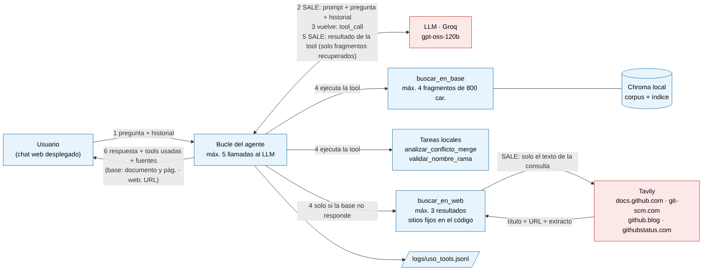

# GitBot — Asistente experto de soporte técnico de Git/GitHub (RAG)

Proyecto de **Desarrollo de Aplicaciones con IA** · Avance 3: el RAG del Avance 2 convertido en un **agente con herramientas** y búsqueda web controlada (el Avance 2 sigue disponible en `src/rag/`).

**Aplicación desplegada:** https://asistentesoportetecnico-nkhdujgquqvskmidnujmfi.streamlit.app/


## ¿Qué hace?

GitBot responde en español preguntas de soporte técnico sobre **autenticación SSH, conflictos de merge y pull requests**, usando únicamente la documentación oficial de GitHub indexada en una base vectorial propia. Cada respuesta cita el documento y el fragmento que la respalda, y cuando la pregunta no está cubierta por la base de conocimientos lo dice en lugar de inventar.

Privacidad: el corpus y el índice vectorial se mantienen en el proyecto (carpeta `chroma_db/`). Al modelo de lenguaje solo se le envían los fragmentos recuperados para cada consulta, nunca el corpus completo.

## Flujo RAG implementado


| Etapa | Archivo | Decisión técnica |
|---|---|---|
| Corpus | `data/docs/` | 31 documentos de GitHub Docs (Markdown) sobre troubleshooting de SSH, conflictos de merge y pull requests. |
| Ingesta | `src/rag/ingesta.py` | Lectores para PDF, DOCX, TXT/MD y HTML. En los `.md` se limpian el front matter, las etiquetas Liquid y los enlaces. |
| Chunking | `src/rag/chunking.py` | `RecursiveCharacterTextSplitter`, 800 caracteres con solapamiento de 120; corta por párrafo, luego línea, frase y palabra. Resultado: 98 chunks (media de 600 caracteres). |
| Embeddings | `src/rag/embeddings.py` | `paraphrase-multilingual-MiniLM-L12-v2` con fastembed (sin PyTorch). Es multilingüe: los documentos están en inglés y las preguntas en español. |
| Índice | `src/rag/vectorstore.py` | Chroma persistente (`chroma_db/`), colección `gitbot_docs`, distancia coseno. Metadatos: `documento` y `pagina`. |
| Recuperación | `src/rag/retrieval.py` | Similitud coseno, `top_k = 4`. |
| Control de alucinaciones | `src/rag/pipeline.py` | Si el mejor fragmento tiene distancia > 0.6 no se llama al LLM; además el LLM marca `en_contexto: false` cuando el contexto no alcanza. |
| Seguimientos | `src/rag/generacion.py` | Antes de buscar, el LLM reescribe la pregunta de seguimiento como pregunta completa usando los últimos 6 mensajes. |
| Generación | `src/rag/prompt.py`, `generacion.py` | Groq `openai/gpt-oss-120b`, temperatura 0.1. System prompt + 3 ejemplos few-shot + historial + contexto numerado en etiquetas XML (`<contexto>`, `<fragmento>`, `<pregunta>`). Salida JSON: `en_contexto`, `diagnostico`, `solucion`, `nivel_confianza`, `fuentes_usadas`. |

## Evaluación con Ragas

Conjunto de 18 preguntas (`evaluacion/preguntas_eval.json`): 14 dentro del corpus con respuesta de referencia y 4 fuera del corpus. Juez: `openai/gpt-oss-120b` en Groq. Las preguntas fuera del corpus se miden aparte con la tasa de rechazo.

| Métrica | Avance 2 (pipeline fijo, `top_k=4`) | Avance 3 (agente) |
|---|---|---|
| faithfulness | 0.885 | 0.593 |
| answer_relevancy | 0.762 | 0.845 |
| context_precision | 0.732 | 0.691 |
| context_recall | 0.899 | 0.816 |
| Rechazo fuera del corpus | 4/4 | 3/4 |

Con el agente mejora la relevancia de la respuesta, pero baja la fidelidad al contexto: el modelo completa con conocimiento propio lo que los fragmentos no traen. El análisis completo, el costo y los casos de comportamiento están en el PDF de entrega.

## Avance 3: agente con herramientas

El LLM (`openai/gpt-oss-120b` en Groq, con *tool calling*) decide si llama una tool; el programa la ejecuta y le devuelve el resultado. No se usa framework: el bucle está escrito con el SDK de Groq (`src/agente/agente.py`), de modo que cada límite y cada decisión se ven en el código.

```
pregunta → LLM → (tool_call) → programa ejecuta la tool → resultado → LLM → ... → respuesta
```



El diagrama se puede editar en `docs/arquitectura_agente.drawio` (draw.io).

### Tools y límites (definidos en el código, `src/agente/herramientas.py`)

| Tool | Tipo | Qué hace | Límites en el código |
|---|---|---|---|
| `buscar_en_base(consulta)` | búsqueda | Recupera fragmentos de la base vectorial local (la recuperación del Avance 2). | Máx. 4 fragmentos por llamada; cada fragmento ≤ 800 caracteres; descarta fragmentos con distancia > 0.6; consulta ≤ 300 caracteres. Cada fragmento trae documento y página. |
| `analizar_conflicto_merge(texto_archivo)` | tarea del dominio | Analiza un archivo pegado con marcadores `<<<<<<<` / `=======` / `>>>>>>>`: cuenta conflictos, ramas de cada lado y líneas de cada versión. | Texto ≤ 6000 caracteres; detalla máx. 5 conflictos y 12 líneas por lado. |
| `validar_nombre_rama(nombre)` | tarea del dominio | Aplica las reglas de `git check-ref-format` y lista las que se incumplen (espacios, `..`, `~^:?*[\\`, `.lock`, etc.). | Nombre ≤ 250 caracteres. |
| `buscar_en_web(consulta)` | web | Busca con Tavily solo en sitios oficiales. | Máx. 3 resultados; solo título, URL y extracto ≤ 300 caracteres; dominios fijos en el código; se bloquea si antes no se consultó la base. |

Las dos tools de tarea existen porque el LLM no debe resolverlas «de memoria»: contar conflictos en un texto y validar un nombre contra reglas exactas son cálculos deterministas.

### Bucle, límites y registro

- **Límite de iteraciones:** máximo 5 llamadas al LLM por pregunta (`AGENTE_MAX_ITERACIONES`); en la última no se ofrecen tools, así que el modelo está obligado a responder.
- **Saludos y conversación casual** se responden sin tools; **preguntas compuestas** pueden llamar `buscar_en_base` varias veces.
- **Prompt del sistema** (`src/agente/prompt_agente.py`): indica cuándo usar cada tool, responder solo con lo que devuelven, citar la fuente y mantiene la respuesta exacta cuando la información no está disponible.
- **Registro de uso:** cada pregunta agrega una línea JSON a `logs/uso_tools.jsonl` con las tools llamadas y sus argumentos, el número de llamadas al LLM, los tokens y el tiempo.

### Política de búsqueda web («primero la base»)

La base de conocimientos **nunca sale del sistema**; solo la consulta que escribe el agente viaja al buscador (Tavily).

- **Cuándo se usa:** solo si `buscar_en_base` no tiene la respuesta **y** la pregunta trata de información pública o actual de Git/GitHub (una versión reciente, una definición general, el estado del servicio). Esta regla está en el docstring de la tool, en el System Prompt y, además, se hace cumplir en código: si el agente intenta buscar en la web sin haber consultado la base, la llamada se bloquea.
- **Sitios permitidos** (fijos en `WEB_SITIOS_PERMITIDOS`; el LLM no puede cambiarlos):

| Sitio | Por qué |
|---|---|
| `docs.github.com` | Documentación oficial de GitHub (la misma fuente del corpus). |
| `git-scm.com` | Sitio oficial de Git: documentación de comandos y versiones. |
| `github.blog` | Blog oficial: anuncios y cambios recientes de la plataforma. |
| `githubstatus.com` | Estado oficial del servicio (información actual). |

- **Resultados acotados:** máximo 3, cada uno con título, URL y extracto corto, marcados con origen «web». Una segunda barrera descarta cualquier URL cuyo dominio no esté en la lista.
- **Respuesta separada por origen:** lo de la base se cita como `Fuente: documento, pág. N` y lo de la web como `[web: URL]`; la interfaz los muestra en secciones distintas.
- **Privacidad:** el prompt indica escribir consultas generales, sin datos del usuario ni contenido de la base.

### Evaluación del agente (se ejecuta en tu equipo)

```bash
pip install -r requirements-eval.txt
python -m evaluacion.evaluar_agente      # Ragas: agente vs. pipeline del Avance 2 (tabla en resultados/comparacion_ragas.md)
python -m evaluacion.evaluar_casos       # 8 casos de comportamiento (esperado escrito en casos_comportamiento.json)
python -m evaluacion.comparar_costo      # llamadas al LLM, tokens y tiempo: pipeline fijo vs. agente
python -m pytest tests -q                # pruebas sin red de las tools y del bucle
```

Probar una tool sin LLM (`.invoke()`):

```bash
python -c "from src.agente.herramientas import HERRAMIENTAS as H; print(H['buscar_en_base'].invoke({'consulta': 'Permission denied (publickey)'}))"
```

## Instalación y ejecución local

```bash
git clone <URL-DEL-REPOSITORIO>
cd asistente_soporte_tecnico
python -m venv .venv
# Windows: .venv\Scripts\activate    |  Linux/Mac: source .venv/bin/activate
pip install -r requirements.txt
```

Crea un archivo `.env` en la raíz (no se sube al repositorio):

```
GROQ_API_KEY=tu_clave_de_groq
TAVILY_API_KEY=tu_clave_de_tavily   # búsqueda web (plan gratuito en tavily.com)
```

(Hay un ejemplo en `.env.example`. Sin `TAVILY_API_KEY` el agente funciona, pero la tool web responde que no está configurada.)

El índice ya viene en `chroma_db/`. Para reconstruirlo desde `data/docs/`:

```bash
python -m src.rag.vectorstore
```

Probar el pipeline por consola y lanzar el chat:

```bash
python -m src.rag.pipeline     # pipeline fijo del Avance 2
python -m src.agente.agente "Hola"   # agente por consola (muestra tools, llamadas y tokens)
python app.py                  # chat con el agente: http://127.0.0.1:5000
```

## Evaluación (solo en tu equipo)

```bash
pip install -r requirements-eval.txt
python -m evaluacion.evaluar_ragas --etiqueta baseline
python -m evaluacion.evaluar_ragas --etiqueta topk3 --top-k 3 --regenerar
```

Los resultados quedan en `evaluacion/resultados/`. Ragas no se instala en el despliegue.

## Despliegue en Render

1. Subir el repositorio a GitHub con `chroma_db/` incluido (no debe estar en `.gitignore`).
2. En Render: **New → Web Service**, conectar el repositorio.
3. Configuración:
   - **Build command:** `pip install -r requirements.txt`
   - **Start command:** `gunicorn app:app --workers 1 --timeout 120`
   - **Environment:** `GROQ_API_KEY` = la clave de Groq, `TAVILY_API_KEY` = la clave de Tavily y `PYTHON_VERSION` = `3.12.3` (o la versión estable que se use).
4. Las claves nunca se escriben en el código ni en el repositorio: solo en las variables de entorno de Render.

Nota: el despliegue de la entrega es el de Streamlit (sección siguiente); Render queda documentado como alternativa. En el plan gratuito el servicio se duerme tras unos minutos sin uso y la primera visita tarda en responder (carga el modelo de embeddings).

## Despliegue en Streamlit Community Cloud

1. En Streamlit Cloud: **New app**, repositorio del proyecto, archivo principal `streamlit_app.py`.
2. En **Settings → Secrets** agregar (nunca en el repositorio):
   ```
   GROQ_API_KEY = "tu_clave_de_groq"
   TAVILY_API_KEY = "tu_clave_de_tavily"
   ```
3. La interfaz muestra, en cada respuesta, las tools usadas con sus argumentos y las fuentes separadas entre la base de conocimientos y la web.
4. La primera vez que arranca, la app reconstruye el índice vectorial en una carpeta temporal y descarga el modelo de embeddings, lo que tarda unos minutos.
5. URL pública: https://asistentesoportetecnico-nkhdujgquqvskmidnujmfi.streamlit.app/

## Estructura

```
app.py                 # servidor Flask del chat
templates/, static/    # interfaz web
src/agente/            # agente: tools, bucle, prompt y registro de uso (Avance 3)
src/rag/               # pipeline RAG (ingesta, chunking, embeddings, índice, recuperación, prompt, generación)
data/docs/             # corpus
chroma_db/             # índice vectorial persistente
evaluacion/            # preguntas, Ragas (pipeline y agente), casos de comportamiento, costo y resultados
tests/                 # pruebas sin red de las tools y del bucle
logs/                  # registro de uso de tools (se genera al ejecutar; no se sube)
docs/                  # diagramas de arquitectura (PNG y draw.io)
```

